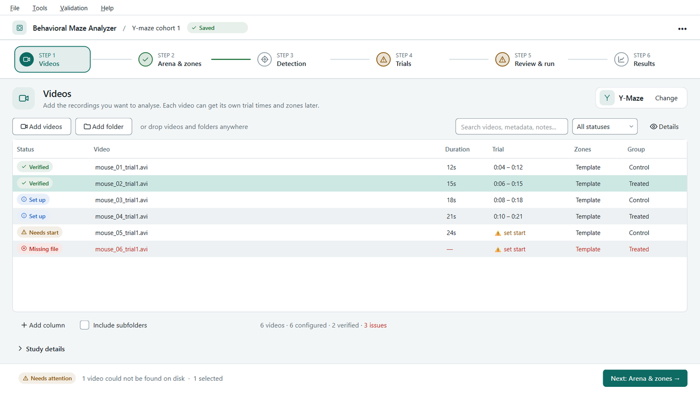
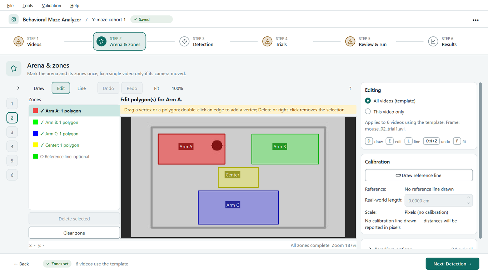
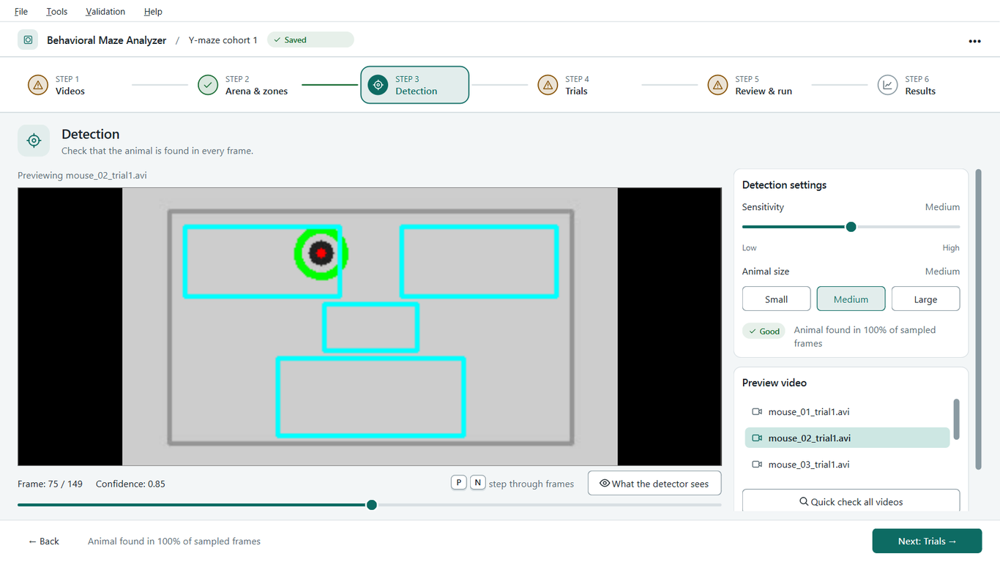
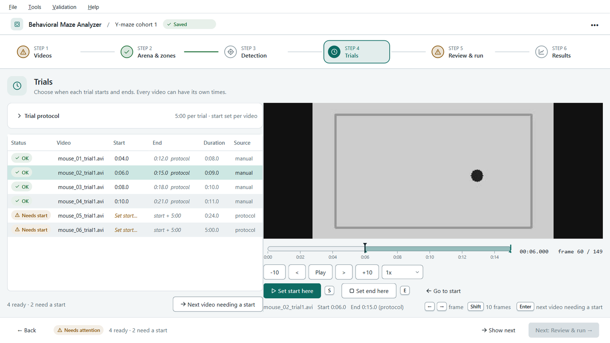
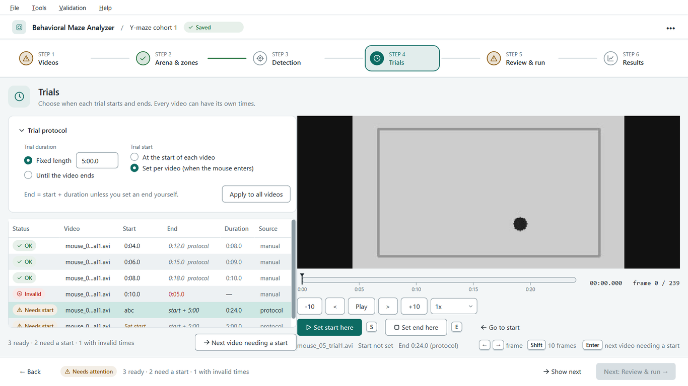
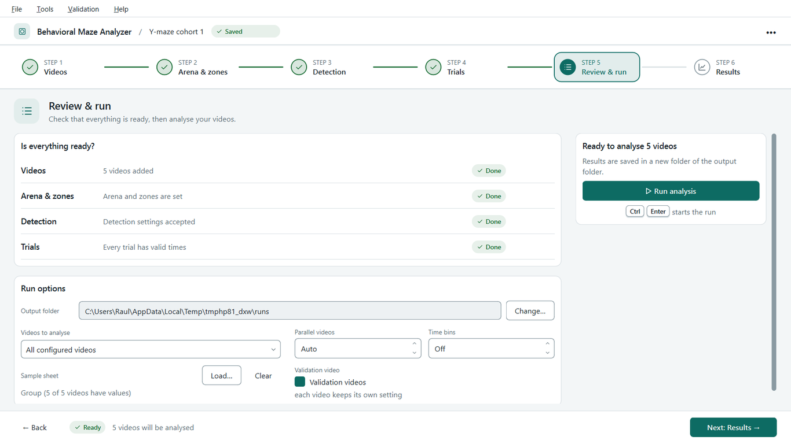
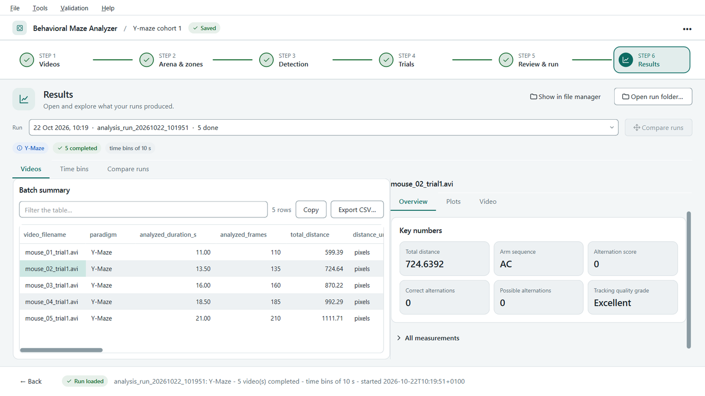

# Quickstart Guide

This guide walks you through a complete analysis in the 4.0 workspace, from
creating a project and adding your first videos to reviewing the heatmaps and
data. If you prefer the 3.x wizard window, see the
[Classic interface](#appendix-classic-interface) appendix at the end.

**What's new in 4.0:** one window instead of a chain of dialogs. A `.bmaproj`
**project** keeps your videos, their settings and the history of your runs, and
the work is a guided flow of **six stages**, each with the whole window:

> **1 Videos** > **2 Arena & zones** > **3 Detection** (**Motion tuning** for the
> Tail Suspension Test) > **4 Trials** > **5 Review & run** > **6 Results**

Edits apply as you make them (there is no Apply button), every video can have
its own trial times and its own zones, and the window follows your operating
system's light or dark setting. Analysis results are unchanged from 3.5.0, and a
workspace run writes the same files as the command line. See `CHANGELOG.md`.

**Earlier releases:** 3.5 added the **Validation** menu (section 8), 3.4 added
parallel videos, the command line, the open-field arena, sample sheets, time
bins and ROI template alignment, and 3.3 added faster analysis, remembered
settings, resume after a restart and keyboard shortcuts. Results are unchanged
since 3.2.0 apart from the additive features; see `CHANGELOG.md`.

## 1. Launch the Application
- **If using the executable (.exe):** Double-click the downloaded file.
- **If using Python:** Open your terminal, activate your virtual environment,
  and run `python gui_main.py`. Add a project file to open it straight away
  (`python gui_main.py study.bmaproj`), or `--classic` for the 3.x wizard window.

The window has a slim bar on top with the project name and whether it is saved,
the **stepper** (the six stages), the **current stage** filling the middle, and
a **footer** with **Back**, a sentence about what is missing (for example "3 of
12 videos need a start time") and **Next**. Each step of the stepper is a stage:
a tick means done, a warning means it needs attention (hover it to see why),
and you can open any stage at any time. **Next** is disabled, with a tooltip
that says why, until the stage has what the following one needs. A **details
drawer** (Ctrl+I, or **Details** on a video row) describes the selected video:
resolution, settings, issues and notes. **Help > Quickstart guide** opens this
guide.

## 2. Create or Open a Project
- **File > New project...** (Ctrl+N) asks for a name and a place for the
  `.bmaproj` file and creates an empty project.
- **File > Open project...** (Ctrl+O) opens a project; **File > Open recent**
  lists the last ones. When the application starts it offers to reopen the
  project you were working on, and opening a project takes you back to the
  stage you left it at.
- Changes are saved with **File > Save** (Ctrl+S) or **Save as...**
  (Ctrl+Shift+S). While you work, the project is also autosaved next to the
  file (`<name>.bmaproj.autosave`); if the application ended before you saved,
  opening the project offers to **recover the autosave**.
- **Coming from 3.x?** The first time the workspace starts with no project and
  you have recent 3.x templates or batch plans, a welcome card offers
  **Create project**, **Open project**, **Import your recent 3.x
  configuration...** and **Use classic interface**. You can also use
  **File > Import > Template...**, **Batch plan...** or **Previous run
  folder...** at any time (or drop a `.json` file on the window). Each import
  creates a new project and leaves the original file untouched.

## 3. Stage 1 - Videos


1. A new project first asks **What test are these videos from?** Pick one of the
   four cards (Y-Maze, Elevated Plus Maze, Tail Suspension Test or Freestyle /
   Open Field). **Change** in the summary line changes it later; that clears the
   settings of configured videos, after asking.
2. Add the videos: **Add videos...** (Ctrl+Shift+V), **Add folder...**
   (Ctrl+Shift+O), or drag videos and folders onto the window. Tick **Include
   subfolders** to take the videos inside the folders of a folder as well.
3. The table shows each video's status (New, Configured, Done, Failed, Warning,
   Interrupted) and, once you have set them, its trial and zone state. Search
   and filter by status, double-click a metadata cell to edit it, and use **Add
   column** for your own metadata (group, dose, ...). A video that moved shows
   an issue in the details drawer: **Relink...** points the project at its new
   folder. Del removes the selected videos, Alt+Up and Alt+Down reorder them.
4. **Study details** holds the project's name and notes.

*All output (CSVs, plots, timelapses) goes in an `analysis_run_...` folder
inside the output folder chosen in Review & run.*

**Next: Arena & zones** is enabled once there is a test and at least one video.

## 4. Stages 2 to 4 - Arena & zones, Detection, Trials
These three stages set the analysis up. They have no **Apply** button: whatever
you change is written to the project at once (slider and vertex drags a moment
after you let go), autosaved, and never lost or asked about when you move to
another stage or close the project. Every video follows the **project template**
unless you give it settings of its own; the settings built here are identical
to the ones the classic wizard produces for the same choices.

### Stage 2 - Arena & zones


The big canvas is the **ROI editor** on a frame from the middle of a video; the
column on the right holds **Editing**, the **Calibration** and the **Paradigm
options**. The video list on the left picks which video's frame you draw on (a
slim rail on a narrow window).

- **Editing: All videos (template)** is the default. What you draw is the zones
  of every video that follows the template, drawn on the first video (or the one
  you picked).
- **Editing: This video only** shows the picked video's own zones on its own
  frame. A video that follows the template shows the template's zones read-only
  ("Looks off?"), which makes a crooked camera easy to spot. Then:
  - **Adjust zones for this video** gives it zones of its own and opens the
    editor on its frame (see the screenshot below);
  - **Auto-align to template** registers the video's background against the
    template's and stores the result as an *aligned* override, rescaling the
    calibration with it (see [Reusing ROIs when the camera moved](#reusing-rois-when-the-camera-moved-or-the-resolution-differs));
  - **Reset to template** drops the override.


The stepper shows a warning on this stage when a video's frame size differs from
the one the zones were drawn on ("Check alignment").

#### Regions of interest (ROI editor)
The **Zones** list on the left of the editor has one row per zone (the arena
first, if it is switched on), and a **Reference line** row at the bottom. Each
row shows whether the zone is done (✓), missing (○) or breaks a rule (✗, for
example a TST mouse with two polygons, or a polygon smaller than 100 px²). Click
any row at any time to draw or edit that zone: there is no fixed order.

**Drawing a zone** (the *Draw* tool, key `D`)
1. Pick the zone in the list (the editor starts on the first missing one).
2. **Click** to drop points around the arm.
3. Press **Enter**, **double-click** or **right-click** to close the polygon.
   **Esc** cancels the shape in progress; **Backspace** removes its last point.
   A zone that takes exactly one polygon (arena, TST mouse) moves you on to the
   next missing zone by itself.
4. New points **snap to existing vertices** within 6 screen pixels, so
   neighbouring zones (for example the Y-maze arms and the center) can share an
   exact border. Hold **Alt** to place a point without snapping.

**Editing** (the *Edit* tool, key `E`): nothing has to be redrawn from scratch.
- Drag a **vertex** to move it, or drag a **polygon** to move all of it.
- **Double-click an edge** to insert a vertex. Press **Delete** or
  **right-click** to remove the selected vertex or polygon (a polygon keeps at
  least three vertices).
- With a polygon selected, the blue handle above it **rotates** and the orange
  handle at its corner **scales** it. The arrow keys nudge the selection by one
  pixel (Shift: ten).
- **Ctrl+Z** undoes and **Ctrl+Shift+Z** (or **Ctrl+Y**) redoes every edit, not
  just the last point. **Clear zone** removes all polygons of the selected zone
  in one undoable step.

**Zoom and pan:** **Ctrl+wheel** zooms at the cursor, **Fit** (or `F`) shows the
whole frame, `1` shows actual size, and a **middle-button drag** or
**Space+drag** pans. The status bar shows the cursor position in source pixels
and the zoom. Press **?** for the list of shortcuts.

#### Calibration
Draw a line along an object of known length in the real world (e.g., a 30cm maze
arm) with the *Line* tool (key `L`, or the Reference line row): click two points
or drag, then drag an end to adjust it; its length in pixels is shown on the
line. **Draw reference line** in the Calibration card jumps to the editor with
the line tool selected, and **Real-world length** takes the length of the line in
cm. This allows the software to output distances in centimeters instead of
pixels. **Always draw a reference line when you want cm**: the software no
longer estimates a scale from the ROI bounding box. The TST does not use
calibration.

#### Paradigm options
Open **Paradigm options** to set what is specific to the test:
- **Y-Maze / Elevated Plus Maze:** the **Minimum dwell time** (a zone change must last this long to count, which ignores flicker across a zone border) and whether to **count the arm the animal starts in as an entry**.
- **Tail Suspension Test:** the **Number of mice**, the **Minimum immobility bout** and the **Maximum bridged gap**.
- **Freestyle / Open Field:** the zone names, the **Immobility threshold** (cm/s), the **Speed smoothing window** (s), the **Minimum immobility bout** (s) and the **Minimum zone dwell** (s). Immobility is scored from the smoothed speed, and is reported as N/A if the video is not calibrated.

- **Open-field arena (Freestyle):** tick **Open field arena (center/periphery)**
  to get center/periphery metrics and thigmotaxis. The ROI editor
  then lists the **arena boundary** first (the floor outline, drawn like any
  zone, before the zones and the reference line). Choose how the center is
  defined: a **distance from the wall in cm** (default 10 cm, needs the
  reference line) or a **share of the arena area** (default 25%; used
  automatically when the video is not calibrated). The ROI editor previews an
  area-share center. The run reports center time, center entries, latency to
  center, thigmotaxis (% of time and of distance), mean distance to the wall
  and center versus periphery speed, and writes `*_arena_zones.csv`. Detection
  is restricted to the arena, and the center outline is drawn in the
  validation video. Zones are optional in this mode; `arena` is a reserved
  zone name. See `OUTPUTS.md`.

#### Reusing ROIs when the camera moved or the resolution differs
A saved template or plan holds ROIs in the pixels of the video they were drawn
on, so a video with another frame size, or one recorded with a slightly moved
camera, would get misplaced regions. The pre-run check still stops a run whose
frame size does not match, but you can **align** the template instead of
redrawing it, one video at a time (**Auto-align to template**, above) or all
the flagged ones at once with **Tools > Align template to videos...**.

1. Choose **Tools > Align template to videos...**. The application asks which
   video the template was drawn on (it remembers it for the session), compares
   each video's animal-free background with that video's, and lists the videos
   that need alignment: a different frame size, or a camera that moved so the
   ROIs would be off by more than 3 px. Videos that already fit are left alone.
2. For each flagged video the alignment window shows the template frame with
   its ROIs (left) and the video's frame with the transformed ROIs (right).
   - **Auto-align** matches the arena in the two background frames. Check the
     quality line: "good: 0.8 px" can be accepted; "check carefully: 6 px"
     means the match is doubtful.
   - **Pick landmarks...** lets you click 3-4 fixed points (arena corners,
     screws) on the template frame and then the same points on the video, in
     the same order. The fit and its residual update after each pair; one point
     more than the minimum lets the residual verify the fit.
   - **Use as is** keeps the ROIs at their pixel positions.
   Accept when the overlay on the right lines up with the arena.
3. If several videos share a frame size, you can reuse one alignment for all of
   them (same camera), or align each separately.

The aligned ROIs are saved with the project (and with an exported batch plan),
and the reference line and cm calibration follow the alignment: the real-world
length you entered stays the same, so cm values remain correct. A template
whose reference line was drawn before 3.4 stores only its length, so the length
is scaled and marked *approximate*; redraw the line for exact cm values.

### Stage 3 - Detection (Motion tuning)


This stage makes sure the software cleanly separates the animal from the
background. The preview is large: the video with the animal marked, and the
detector's confidence for the frame shown under it. Use the slider under the
preview (or `N` and `P`) to look at different parts of the video, and **What the
detector sees** to switch the preview to the picture the detector works on (the
animal it picked is the green blob).

- **Detection settings** has two plain controls: **Sensitivity** (how easily a
  pixel counts as part of the animal; raise it to find a pale animal) and
  **Animal size** (how big the animal looks, which sets the smallest blob that
  counts). A chip says **Good**, **Check** or **Poor** for the frame you are
  looking at and why. "Custom (advanced)" appears if you have set values the
  simple controls cannot show; touching a control is the only thing that
  changes them.
- **Preview video** picks which video you look at (the settings are shared by
  every video that follows the template). **Quick check all videos** scans every
  video in the background, with progress and **Cancel**, and gives each a Good /
  Check / Poor chip so a bad video stands out.
- **Advanced** holds every slider (threshold, minimum component area,
  morphology, ...), kept in step with the simple controls. Adjust them until the
  green selected component covers the animal without selecting reflections or
  shadows. "Review" or "Poor" quality means the validation output must be
  inspected and the settings may need adjustment.

For the **Tail Suspension Test** the stage is called **Motion tuning**. Movement
is told apart from stillness automatically; the one plain setting is how long
stillness must last before it counts as immobility, and the classifier settings
are under **Classifier settings**. Select each mouse in turn and review the
state overlay across the scan. Purple is coherent passive swing, red is static
immobility, green is active escape, and orange/yellow is uncertain and excluded
from scoring. The tuner reviews up to five minutes to remain responsive; the
actual analysis uses the entire selected interval.

The stage asks you to draw the zones first (with a link to **Arena & zones**)
if there are none yet. The stepper shows **Detection** as done once you have
looked at the preview or changed a setting.

### Stage 4 - Trials


Every mouse is put in the apparatus at a different moment, so every video can
have **its own start time**; its end is usually the start plus a fixed trial
length. The table has one row per video with its **Status**, **Start**, **End**,
**Duration** and **Source** (the *protocol* or *manual*); for the Tail
Suspension Test every mouse has its own row and window.

- **Type a time** in the Start, End or Duration cell (`90`, `1:30` or `1:30.5`).
  Anything that cannot be used shows in red with the reason as a tooltip, and
  what you typed is kept.
- **Or play the video** in the player on the right and press `S` at the frame
  where the mouse is in place (**Set start here**) and `E` where the trial ends
  (**Set end here**). `Left` / `Right` step one frame (`Shift`: ten), and `Enter`
  (or `N`) selects the next video that still needs a start, so a whole cohort is
  tagged with the keyboard alone. The shaded bar under the player shows the
  trial.
- **Trial protocol** (the card above the table) sets how long a trial lasts
  ("Fixed length" or "Until the video ends") and whether trials start with the
  video or at a moment set per video. **Apply to all videos** makes every video
  follow the protocol again (its own ends are removed, and its own starts too
  when trials start with the video).



**Next: Review & run** is enabled once every video's trial is valid and has its
start; the footer says how many still need one.

## 5. Stage 5 - Review & run


Review & run checks that everything is ready and starts the analysis. It runs
exactly what the classic window and the command line run: the same files come
out for the same settings.

**Is everything ready?** One row per earlier stage (Videos, Arena & zones,
Detection, Trials) with a status chip, a one-line reason and a **Fix** link that
opens the stage. *Not reviewed* on Detection is a reminder, not a blocker.
Problems found in single videos are listed underneath, grouped by kind (video
files not found, no settings yet, start time needed, trial times that cannot be
used, zones drawn on another frame size, ...), each with the videos concerned
and the **Fix** link of the stage that solves it. A video without settings is
left out of a run of *All* videos with a warning, and blocks a run of *Selected*
videos.

**Run analysis** (also `Ctrl+Enter`) is disabled until nothing blocks the run;
hover it to read why. Pressing it first checks the plan in one go: videos
without settings or whose file is missing, the paradigm, the paradigm's own
checks, metadata columns that clash with output columns, and the usual
pre-flight checks (video, disk and system). Problems stop the run and stay
listed on the page until you change something; warnings are listed once and you
confirm them.

**Run options**
- **Output folder.** Each run creates an `analysis_run_...` folder inside it.
  It defaults to `runs/` next to the project file; **Change...** picks another
  folder and the workspace remembers it for that project.
- **Videos to analyse.** *All configured videos*, *Selected videos* (the rows
  selected in the Videos stage) or *Videos not yet done* (no finished analysis
  yet).
- **Parallel videos** sets how many videos are analysed at the same time.
  **Auto** (the default) picks `min(CPU cores / 4, videos, RAM in GB / 3)`, at
  least 1; 1 runs the videos one after another. Outputs are byte-identical to
  a sequential run.
- **Time bins** also reports the metrics in consecutive bins of N minutes (Off
  by default; see `OUTPUTS.md`). Both settings are saved in the project.
- **Sample sheet.** **Load...** attaches animal information to the results. A
  sample sheet is a CSV whose first column is `video` (a bare filename, or a
  path relative to the sheet) followed by any columns you like:

  ```text
  video,animal_id,group,sex
  mouse1.mp4,A01,control,F
  mouse2.mp4,A02,treated,M
  ```

  The line under the title shows the sheet and how many videos have values; the
  values are loaded into the video table. Those columns appear in
  `batch_summary.csv` (after the shared columns), in each video's
  `*_summary.json` and in `manifest.json`. Videos with no row, or whose
  filename matches several rows, are listed, and you are asked before starting
  with blank metadata for them. **Clear** removes the sheet and the metadata.
- **Validation video** has three states. Partly filled (the default) keeps each
  video's own setting; checked or unchecked creates or skips the validation
  video for every video of *this run* only. The project's settings are not
  changed.

**While it runs** the same stage shows the progress: an overall bar with the
batch ETA, a table with each video's status, progress, ETA and last message (a
percentage per video is only known when videos run one after another), and a
collapsible **Log** you can filter by level and text (**Save log...** keeps it).
The rest of the project is locked. You can look at other stages while it runs.
**Cancel run** asks first and saves a checkpoint. Closing the window during a
run asks, cancels, and closes by itself once the run has stopped.

**When it ends** the run is added to the project's run history (the table
statuses update) and a summary card shows how many videos completed, failed or
have quality warnings, with **View results** (the Results stage, showing that
run), **Open folder**, and **Resume interrupted run**, which appears when the
output folder holds checkpoints of project videos whose settings are unchanged;
it continues them from where they stopped, even after closing the application.
**Back to run options** returns to the options.

### Running from the command line
A saved batch plan (**File > Export batch plan...** in the workspace, or the
`run_plan.json` of an earlier run) can be analysed without the GUI, for example
on a server:

```bash
python -m core.cli run --plan plan.json --out results --workers 2
```

The run folder is created inside `results` and is identical to a GUI run.
Options: `--workers N` (default Auto), `--sample-sheet`, `--bin-seconds`,
`--quiet`, and `--videos` (plus `--paradigm`) when you pass a template instead of
a plan. Exit codes: `0` success, `1` a video failed, `2` bad arguments or
plan, `130` cancelled. Headless with metadata and bins: `python -m core.cli run
--plan plan.json --out DIR --sample-sheet sheet.csv --bin-seconds 60`.

## 6. Stage 6 - Results


The Results stage opens a finished run and shows what it produced. The **Run**
picker lists the project's runs, newest first, with date and counts;
**Open run folder...** opens any other run (manifest schema 3, and older runs as
far as they were recorded), and **Show in file manager** reveals it on disk. With
no run yet the stage says so and links to Review & run.

- **Videos.** `batch_summary.csv` as a table: click a header to sort (numbers
  sort as numbers), type in **Filter the table...** to filter every column,
  select cells and press Ctrl+C (or **Copy**) to copy them, or **Export
  CSV...** to save the rows as shown. A warning badge marks videos with quality
  warnings.
- **The selected video** has an *Overview* (its key numbers as tiles, any
  quality warnings, and every measurement under **All measurements**, including
  the sample-sheet values), *Plots* (thumbnails; click one to enlarge it) and
  *Video*. The video tab plays the validation video when the run made one.
  Otherwise it plays the original video with the analysis drawn on it: the
  tracked position, its trail, the zone and the ROIs for tracking paradigms, and
  each mouse's state in the usual colours for the Tail Suspension Test.
- **Time bins.** When the run had time bins, chart one metric over the bins per
  video, or choose **Group by** a metadata column to average each group (error
  bars are the standard error of the mean; the legend gives n).
- **Compare runs.** Choose two runs (for example before and after re-analysing)
  and compare their batch summaries video by video. Changed values are
  highlighted and show both values; **Only changed videos** hides the rest.

### The run folder
Everything is also on disk. Open the new `analysis_run_...` folder inside your
output folder. It contains `batch_summary.csv`, a `manifest.json` run index,
and one folder per video. Each video folder separates:

1. `data/`: frame-level data, human-readable summary, complete JSON, and any
   paradigm-specific event tables.
2. `plots/`: heatmaps, trajectories, time series, and paradigm-specific plots.
3. `media/`: optional annotated validation video; this folder is omitted when
   validation media was not requested.

The batch summary always includes the shared duration, total-distance/unit,
excluded-jump, and tracking-quality columns before paradigm-specific metrics.
Unsupported fields, such as centroid distance for TST, are left blank rather
than reported as zero. See `OUTPUTS.md` for the full per-paradigm output
matrix.

In tracking CSVs, `zone=undetected` means no reliable position was available
for that frame. These frames are excluded from zone occupancy, distance,
transition, and immobility calculations. The same file includes `confidence`
and `failure_reason` columns for quality review.

Configurations saved by releases before 3.2 cannot be used for TST. Re-open
the source video, review every mouse with the temporal evidence tuner, and
save a new configuration.

Results from 3.2.0 are not directly comparable with 3.1.x; see
`CHANGELOG.md`. Results from 3.3.0 are identical to 3.2.0 and can be pooled
with them, 3.5.0 results are unchanged from 3.4.0, and 4.0.0 results are
unchanged from 3.5.0. Criterion validation of the automated scores against
blinded manual scoring must be performed per lab/setup (see section 8 and
`VALIDATION_PROTOCOL.md`) before results are published; until then, review the
validation video before interpreting results.

## 7. Sharing Work with 3.x
**File > Export batch plan...** writes the configured videos of the project as
a 3.x batch plan, which the classic interface and the command line can load.
Videos without settings are left out (you are told how many). `.bmaproj` files
use schema 2 (older pre-release files are migrated when opened) and cannot be
opened by versions before 4.0.

## 8. Validate the Automated Scores (Validation Menu)

The **Validation** menu (in both interfaces) lets you check the automated
scores against your own blinded manual scoring, without leaving the
application. See `VALIDATION_PROTOCOL.md` for how to choose the recordings and
read the result.

1. **Score a video manually...**: pick the paradigm and the raw video, enter
   your initials and press the hotkeys as events happen (Y-maze `A`/`B`/`C`
   for arm entries, EPM `1`-`4` for the arms and `0` for the center, open field
   `C` to toggle between center and periphery, TST hold `I`/`P`/`A`/`U`). Space
   plays, Left/Right step a frame, Shift+Left/Right jump 10 frames, Ctrl+Z
   undoes. The scoring is blind: no analysis result is shown. Progress is
   autosaved and resumes when you reopen the same video with the same
   initials; **Save annotation files** writes the manual CSVs
   (`*_manual_arm_entries.csv`, `*_manual_epm_totals.csv`,
   `*_manual_zone_intervals.csv` or `*_manual_tst_annotations.csv`) to the
   **Save to** folder, which defaults to the video's folder.
2. **Tracking spot-check...**: choose a run folder, click the animal in random
   frames (50 by default, with a fixed seed that is shown and recorded; the
   tracker's dot is hidden) and read the position error, miss rate and false
   detections. The results are saved as `*_position_spotcheck.csv` and
   `*_position_spotcheck_summary.json`.
3. **Build validation report...**: add the run folder and the folder with the
   manual files, check the video matching, set the acceptance criteria (the
   **Protocol defaults** include ICC >= 0.90) and build. You get one
   self-contained `validation_report.html` and a CSV for each table in the
   output folder. The file formats are described in `OUTPUTS.md`.

## 9. Keyboard Shortcuts and Saved Settings

| Where | Keys | Action |
|---|---|---|
| Workspace | Ctrl+N | New project |
| Workspace | Ctrl+O | Open a project (or import a template or batch plan) |
| Workspace | Ctrl+S | Save the project |
| Workspace | Ctrl+Shift+S | Save the project as... |
| Workspace | Ctrl+W | Close the project |
| Workspace | Ctrl+Q | Quit |
| Workspace | Ctrl+Shift+V | Add videos |
| Workspace | Ctrl+Shift+O | Add a folder of videos |
| Workspace | F5 | Go to Review & run |
| Workspace | Ctrl+PgDown, Ctrl+PgUp | Next or previous stage (Next is held back until the stage has what the next needs) |
| Workspace | Ctrl+I | Show or hide the details of the selected video |
| Review & run | Ctrl+Enter | Run the analysis (when nothing blocks it); Cancel is its button and has no key |
| Video table | Del | Remove the selected videos from the project |
| Video table | Alt+Up, Alt+Down | Move the selected videos up or down |
| Video table | F2 or double-click | Edit a metadata cell |
| Trials | S, E | Set the start or the end of the trial at the frame on screen |
| Trials | Left, Right (Shift: x10) | Step one frame |
| Trials | Enter, N | Select the next video that still needs a start |
| Results table | Ctrl+C | Copy the selected cells |
| Results video player | Space | Play or pause (when the player has focus) |
| Results video player | Left, Right | Step one frame |
| Results video player | Shift+Left, Shift+Right | Step ten frames |
| Results video player | Home, End | First or last frame |
| ROI editor | Click | Add a point to the polygon being drawn (snaps to nearby vertices) |
| ROI editor | Enter, double-click, right-click | Close the polygon; with none open, go to the next zone to do |
| ROI editor | Esc | Cancel the polygon in progress (in the classic dialog, Esc again closes the editor, asking first) |
| ROI editor | Backspace | Remove the last point |
| ROI editor | Ctrl+Z | Undo any edit (pending points first) |
| ROI editor | Ctrl+Shift+Z, Ctrl+Y | Redo |
| ROI editor | D, E, L | Draw, Edit and reference-Line tools |
| ROI editor | Delete, right-click | Delete the selected vertex or polygon (the line, in the Line tool) |
| ROI editor | Double-click an edge | Insert a vertex |
| ROI editor | Arrow keys (Shift: x10) | Nudge the selected vertex or polygon by 1 px |
| ROI editor | Alt (held) | Place or drag a point without snapping |
| ROI editor | Ctrl+wheel | Zoom at the cursor |
| ROI editor | Middle-drag, Space+drag | Pan |
| ROI editor | F or Ctrl+0, 1 or Ctrl+1 | Fit the frame, actual size (100%) |
| ROI editor | ? or F1 | Show or hide the shortcut help |
| TST tuner | Space | Play or pause |
| TST tuner | Left, Right | Step one frame |
| TST tuner | Ctrl+Left, Ctrl+Right | Step ten frames |
| Detection tuner | N, P | Next or previous frame |
| Detection tuner | + (or =), - | Forward or back 100 frames |
| Manual scoring | Space | Play or pause |
| Manual scoring | Left, Right | Step one frame |
| Manual scoring | Shift+Left, Shift+Right | Step ten frames |
| Manual scoring | Home, End | First or last frame |
| Manual scoring | Ctrl+Z, Delete | Undo; delete the selected row |
| Manual scoring | A/B/C, 1-4, 0, C, I/P/A/U | Score (depends on the paradigm; shown in the dialog) |
| Spot-check | N | Animal not visible |
| Spot-check | Backspace, Left | Previous frame |

The application remembers folders, window layout, the last paradigm, recent
files, recent projects, the project that was open last, each project's run
output folder and whether the welcome card was dismissed. They are stored in
your user profile with Qt's QSettings (the registry on Windows), not next to
the executable. Set the `BEHAVIORAL_MAZE_ANALYZER_SETTINGS_FILE` environment
variable to the path of an ini file to store them there instead.

## 10. Developer Checks
If you are running from source, check an installation or a change with:

```bash
python -m unittest discover -s tests
python -m ruff check .
```

Set `QT_QPA_PLATFORM=offscreen` for the tests on a machine without a display.

## Appendix: Classic interface

The 3.x wizard window runs the same analysis and is still available: start it
with `python gui_main.py --classic`, or choose **File > Switch to classic
interface** in the workspace. Here the settings are not kept in a project: you
add videos, run a chain of setup dialogs and start the batch.

### Load your videos
Click **Add Videos** or **Add Folder** at the top of the main window (Ctrl+O and
Ctrl+Shift+O). *All output files (CSVs, plots, timelapses) are saved in the
same directory as the first video in your list, unless you change it via
**Tools > Set Output Directory...**.*

### Configure
Click **Configure & Start Analysis** (F5, or **Run > Configure and Start
Analysis**). The same building blocks as in the Arena & zones, Detection and Trials stages appear as dialogs, one
after the other:

1. **Select the maze type** (Y-Maze, Elevated Plus Maze, Tail Suspension Test
   or Freestyle / Open Field).
2. **Draw and edit the regions of interest** in the ROI editor, with the
   reference line for calibration. Pressing **OK** without a line asks once
   whether to draw one. **Cancel** asks before it throws away changes. See
   "Regions of interest" in section 4.
3. **Paradigm options** (dwell time, initial arm, immobility parameters,
   open-field arena), see "Paradigm parameters" in section 4.
4. **Tune detection** with the Interactive Detection Tuner (or the TST motion
   tuner) and click **Accept Parameters**.
5. **Final review:** adjust the **Start Time** and **End Time**, enter the
   real-world length of the calibration line and tick **Create validation video
   (annotated)**.

### Run the batch analysis
- If you have multiple videos loaded, the software asks whether to **Review
  each video…** or **Run all now**.
  - **Review each video:** adjust start/end times or **Redraw ROIs** if the
    camera moved between recordings: the ROI editor opens with the current
    ROIs, arena and reference line already loaded, so you only move what
    changed.
  - **Run all now:** applies the exact same ROIs and settings to every video in
    the list.
- A single summary box lists the settings and any pre-flight warnings. Click
  **Start analysis** to begin. The progress bar shows the estimated time
  remaining for the batch.
- To stop, click **Cancel Analysis** (or press Esc) and confirm. The software
  saves a checkpoint, and you can resume from the exact same frame later.
- **Parallel videos** (next to the Start button) works as in Review & run.
  **Sample sheet...** and **Time bins** (in minutes here) are under the Start
  button; they behave as described in section 5.

### Save, load and resume
- **File > Save Template...** (Ctrl+S) and **File > Load Configuration /
  Plan...** (Ctrl+L) save and load the settings of the batch. A configuration
  or plan can also be turned into a project with **File > Import** in the
  workspace.
- **File > Load settings from previous run...** reuses the settings of an
  earlier run for new videos.
- Every run folder contains a `run_plan.json` with the exact settings of the
  run. If a run was interrupted, even by closing the application, reopen the
  application (or add the same videos again): a **Resume interrupted run**
  banner (also **File > Resume interrupted run...**) reloads the matching plan
  and continues from the saved frame.
- To align a template to videos whose camera moved, load the template with
  **File > Load Configuration / Plan...**, add the videos and choose **Tools >
  Align template to videos...** (see "Reusing ROIs when the camera moved" in
  section 4). The same window opens automatically when you start a run and some
  videos have a different frame size than the ROIs, and through **Check
  alignment** while you review each video.

### Classic keyboard shortcuts

| Where | Keys | Action |
|---|---|---|
| Main window | Ctrl+O | Add videos |
| Main window | Ctrl+Shift+O | Add a folder of videos |
| Main window | Ctrl+S | Save template |
| Main window | Ctrl+L | Load configuration or batch plan |
| Main window | F5 | Configure and start analysis |
| Main window | Esc | Cancel the running analysis (asks for confirmation) |
| Video list | Del or Backspace | Remove the selected videos |
| Video list | Alt+Up, Alt+Down | Move the selected videos up or down |

The editors, tuners and validation dialogs use the shortcuts of section 9.
